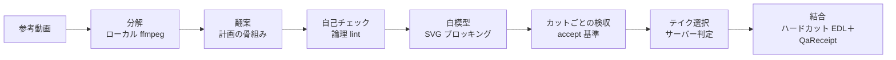

# nikuniku ディレクターキット（director kit）

🌐 [English](README.md) · [繁體中文](README.zh-Hant.md) · **日本語**

ショート動画やショートドラマの**構造**——テンポ、カット割り、フックの位置——を借りて、自分の新しい物語として撮り直すための作業台です。コマンドラインからも、MCP 対応の IDE エージェントからも使えます。

> **状態：レシピ実行はまだ本番サービスにつながっていません。** 以下の手順はすべて、テストに同梱のローカル mock サーバーに対して最後まで動きます。`https://api.nikuniku.ai` に対しては、[SPEC §8](SPEC.md) のサーバー側インターフェースが公開されるまで、`shoot`／`run` は `ACCEPTANCE_UNAVAILABLE` で止まります。このツール自体が映像を生成することはありません。

## できること

クライアントは準備と検査、サーバーは生成と判定を受け持ちます。



| 手順 | コマンド | 実行場所 | キー |
|---|---|---|---|
| 参考動画と権利状態を記録 | `source` | ローカル | 不要 |
| カット検出、キーフレーム、SRT 取り込み | `breakdown` | ローカル（ffmpeg） | 不要 |
| 1〜2 本の分解から計画の骨組みを作る | `plan` | ローカル | 不要 |
| 突然現れる人物、登場前に使われる小道具、時系列の逆行、台詞の写しを検出 | `lint` | ローカル | 不要 |
| シーンの箱を各カットのカメラで SVG に投影 | `whitebox` | ローカル | 不要 |
| テイクを 1 本ずつ見積・送信・ポーリングし、**サーバー**が合格とした最初のテイクを採用 | `shoot` | nikuniku `/v1` | 必要 |
| 採用テイクをサーバーに再確認してから結合 | `assemble` | ローカル＋`/v1` | 必要 |
| 完成品をオフラインで再検証 | `assemble --verify` | ローカル | 不要 |
| `shoot` → ダウンロード → `assemble` を一度に | `run` | nikuniku `/v1` | 必要 |

全体を通すルール：

- **構造だけを借ります。** 骨組みは元動画の台詞・人物・小道具を持ち込みません。翻案はあなたか IDE エージェントが書きます。`lint` は元動画に近すぎる台詞を指摘します（L004）。ある使い方が適法かどうかはこのツールでは判断できず、弁護士の確認が必要です。
- **送信前に、カットごとの検収方法を決めておきます。** `accept` のないカットはリクエストを 1 件も送らずに拒否されます。
- **クライアントはテイクを判定しません。** サーバーが `passed` とした最初のテイクだけを採用し、同じ種類の失敗が 3 回続けば止まります。「全部失敗なら一番ましなもの」はありません。
- **ローカルの記録は証明になりません。** ledger と QaReceipt は持っている人が書き換えられるため、`assemble --verify` は常に `server_acceptance: "unverified"` を返します。

## mock で 5 分

Node 22 以上と ffmpeg が必要です。リポジトリのルートで実行します。

```bash
npm install
node scripts/make-fixtures.mjs
mkdir -p demo
```

準備——キー不要、ネットワーク不要：

```bash
node cli/nikuniku.mjs source --file fixtures/x.mp4 --rights unknown --source-lang en --out demo/source.json
node cli/nikuniku.mjs breakdown fixtures/x.mp4 --source demo/source.json --frames demo/frames --out demo/breakdown.json
echo "Keep the rhythm, tell a new story: a rainy night in a small bookshop." > demo/brief.txt
node cli/nikuniku.mjs plan --a demo/breakdown.json --brief demo/brief.txt --plan-lang en --project demo --out demo/plan.json
node cli/nikuniku.mjs lint demo/plan.json --source demo/breakdown.json --out demo/lint-report.json
node cli/nikuniku.mjs whitebox schemas/examples/plan.ab-merge.json --dir demo/whitebox
```

`lint` は `L006_ACCEPT_MISSING` の警告 3 件付きで通ります。骨組みは `accept` を空けたままにしてあり、あなたが埋めます。

サンプル計画（各カットに `accept` 記入済み）で、ローカル mock に対して撮影と結合：

```bash
node -e 'const fs=require("fs");const p=JSON.parse(fs.readFileSync("schemas/examples/plan.ab-merge.json","utf8"));p.sources=[];fs.writeFileSync("demo/shoot-plan.json",JSON.stringify(p,null,1))'
node --input-type=module -e "import {start} from './tests/mock-api.mjs';const m=await start({director:{files:{s1:'fixtures/takes/s1.mp4',s2:'fixtures/takes/s2.mp4'}}});console.log(m.base)" > demo/mock-url &
MOCK_PID=$!
sleep 1
export NIKUNIKU_API_BASE=$(cat demo/mock-url) NIKUNIKU_API_KEY=nk_test_mock_key NIKUNIKU_POLL_MS=50
node cli/nikuniku.mjs run demo/shoot-plan.json --out demo/out/final.mp4
node cli/nikuniku.mjs assemble --verify demo/out/qa-receipt.json --takes demo/out/takes
kill $MOCK_PID
```

1 行目はサンプルの `sources`（仮の分解ファイルを指す）を外します。`nk_test_mock_key` は mock 専用のテストキーで、本物ではありません。終わると `demo/out/final.mp4`、`gacha-ledger.json`、`edl.json`、`qa-receipt.json` ができ、最後のコマンドが「結合は一致」と「nikuniku による検収ではない」ことを表示します。

## IDE エージェントから使う

同じ機能が既存の `nikuniku` MCP サーバー（`mcp/nikuniku-mcp.mjs`）のツールとして、同じキーで使えます：

| ツール | キー | 副作用 |
|---|---|---|
| `nikuniku_director_validate` | 不要 | なし |
| `nikuniku_director_lint` | 不要 | なし |
| `nikuniku_director_whitebox` | 不要 | SVG を 1 つ書く |
| `nikuniku_director_take_submit` | 必要 | クレジットを予約；1 回の呼び出しで新しいテイクは最大 1 本 |
| `nikuniku_director_take_status` | 必要 | ledger を更新；送信は一切しない |
| `nikuniku_mv_draft` | 必要 | 画像と曲をアップロードし、下書きと見積を保存；送信はしない |

一般パッケージには成人向けツールや成人向けホストは含まれません。追加されるとサーバーは起動を拒否します。

## 出力の約束

- stdout は JSON 1 行だけ。
- エラー時、stderr の 1 行目は翻訳しない JSON `{ok:false,error:{code,message}}`、2 行目はローカライズされたメッセージ（14 言語、`--lang` または `NIKUNIKU_LANG`）。
- 終了コード：`0` 成功 · `1` API／ネットワーク／実行時エラー · `2` 送信前に拒否 · `3` 検査不合格 · `4` クレジット上限超過。エラーコードの一覧は [SPEC §5](SPEC.md)。

## 拡張するには

- **データ契約**は `schemas/*.schema.json`。各段階は前段に sha256 で結び付いた JSON を 1 つ書きます。`schemas/examples/` に正例、`schemas/examples/invalid/` に拒否される例を足して、`node scripts/validate-schemas.mjs` を実行します。
- JSON Schema で書けない**項目間のルール**は `director/semantics.mjs` に。
- **新しい lint ルール**は `director/lint.mjs` に安定したコード（`L0xx_…`）で追加し、`tests/lint-fixtures.test.mjs` にフィクスチャのテスト、SPEC §3 S4 に 1 行を足します。
- **新しいエラーコード**は SPEC §5 に 1 行、14 個の `locales/director/*.json` すべてに `error.<CODE>` が必要です。足りないと `tests/locales.test.mjs` が失敗します。
- **すべての防御には、外すと失敗するテストを。** その行を消して `npm test` を実行し、赤くなることを確かめます。

`npm test` はローカルで mock に対して全テストを実行し、本物の API は呼びません。

## さらに読む

- [SPEC.md](SPEC.md)：全体設計——S1〜S10 の各段階、データ契約、受け入れ基準、サーバー側インターフェースの草案（繁体字中国語、コードとキーワードは英語）。
