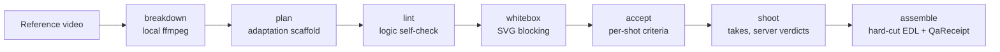

# nikuniku director kit

🌐 **English** · [繁體中文](README.zh-Hant.md) · [日本語](README.ja.md)

A director's workbench for remaking the *structure* of a short video or short drama — its rhythm, shot grammar and hook
positions — as a new story of your own. It runs from the command line, from any MCP-capable IDE agent, or both.

> **Status: recipe execution is not yet connected to the production service.** Every step below runs end to end
> against the local mock server that ships with the tests. Against `https://api.nikuniku.ai`, `shoot` and `run` stop
> with `ACCEPTANCE_UNAVAILABLE` until the server interface in [SPEC §8](SPEC.md)
> is live. Nothing here generates footage on its own.

## What it does

The client prepares and checks; the server generates and judges.



| Step | Command | Where it runs | Needs a key |
|---|---|---|---|
| Record the reference and its rights status | `source` | local | no |
| Cut detection, key frames, SRT import | `breakdown` | local (ffmpeg) | no |
| Turn one or two breakdowns into a plan scaffold | `plan` | local | no |
| Catch characters who appear from nowhere, props used before they enter, timeline regressions, copied dialogue | `lint` | local | no |
| Project scene boxes through each shot's camera to SVG | `whitebox` | local | no |
| Quote, submit and poll one take at a time; adopt the first take the **server** passes | `shoot` | nikuniku `/v1` | yes |
| Re-check every adopted take with the server, then cut | `assemble` | local + `/v1` | yes |
| Re-check a finished cut offline | `assemble --verify` | local | no |
| `shoot` → download → `assemble` in one go | `run` | nikuniku `/v1` | yes |

A few rules shape everything else:

- **Structure only.** The scaffold never copies source dialogue, characters or props; the adaptation is written by you
  or your IDE agent. `lint` flags dialogue that is too close to the source (L004). Whether a particular use is lawful
  is not something this tool decides — that needs a lawyer.
- **Every shot declares how it will be judged before anything is sent.** A shot without `accept` is refused with zero
  requests.
- **The client never judges a take.** It adopts the first take whose server verdict is `passed`, stops after three
  failures of the same kind, and never falls back to "the best of the failures".
- **Local records are not proof.** The ledger and the QaReceipt can be edited by whoever holds them. `assemble --verify`
  therefore always reports `server_acceptance: "unverified"`.

## Five minutes with the mock

Needs Node 22+ and ffmpeg. Run from the repository root.

```bash
npm install
node scripts/make-fixtures.mjs
mkdir -p demo
```

Prepare — no key, no network:

```bash
node cli/nikuniku.mjs source --file fixtures/x.mp4 --rights unknown --source-lang en --out demo/source.json
node cli/nikuniku.mjs breakdown fixtures/x.mp4 --source demo/source.json --frames demo/frames --out demo/breakdown.json
echo "Keep the rhythm, tell a new story: a rainy night in a small bookshop." > demo/brief.txt
node cli/nikuniku.mjs plan --a demo/breakdown.json --brief demo/brief.txt --plan-lang en --project demo --out demo/plan.json
node cli/nikuniku.mjs lint demo/plan.json --source demo/breakdown.json --out demo/lint-report.json
node cli/nikuniku.mjs whitebox schemas/examples/plan.ab-merge.json --dir demo/whitebox
```

`lint` passes with three `L006_ACCEPT_MISSING` warnings: the scaffold leaves `accept` empty for you to fill in.

Shoot and assemble against the local mock, using the example plan (its shots already declare `accept`):

```bash
node -e 'const fs=require("fs");const p=JSON.parse(fs.readFileSync("schemas/examples/plan.ab-merge.json","utf8"));p.sources=[];fs.writeFileSync("demo/shoot-plan.json",JSON.stringify(p,null,1))'
node --input-type=module -e "import {start} from './tests/mock-api.mjs';const m=await start({director:{files:{s1:'fixtures/takes/s1.mp4',s2:'fixtures/takes/s2.mp4'}}});console.log(m.base)" > demo/mock-url &
MOCK_PID=$!
sleep 1
export NIKUNIKU_API_BASE=$(cat demo/mock-url) NIKUNIKU_API_KEY=nk_test_mock_key NIKUNIKU_POLL_MS=50
node cli/nikuniku.mjs run demo/shoot-plan.json --out demo/out/final.mp4
node cli/nikuniku.mjs assemble --verify demo/out/qa-receipt.json --takes demo/out/takes
kill $MOCK_PID
```

The first line drops the example's `sources`, which point at placeholder breakdowns. `nk_test_mock_key` is the mock's
own test key, not a real one. You end up with `demo/out/final.mp4`, `gacha-ledger.json`, `edl.json` and
`qa-receipt.json`; the last command prints that the cut matches and that it is *not verified by nikuniku*.

## Using it from an IDE agent

The same functions are tools on the existing `nikuniku` MCP server (`mcp/nikuniku-mcp.mjs`), with the same key:

| Tool | Needs a key | Side effect |
|---|---|---|
| `nikuniku_director_validate` | no | none |
| `nikuniku_director_lint` | no | none |
| `nikuniku_director_whitebox` | no | writes one SVG |
| `nikuniku_director_take_submit` | yes | reserves credits; at most one new take per call |
| `nikuniku_director_take_status` | yes | updates the ledger; never submits |
| `nikuniku_mv_draft` | yes | uploads images and a song, saves a draft and a quote; does not submit |

The general package contains no adult tools or adult hosts; the server refuses to start if one is added.

## Output contract

- stdout carries exactly one line of JSON.
- On error, the first stderr line is untranslated JSON `{ok:false,error:{code,message}}` and the second is a localized
  message (14 languages, `--lang` or `NIKUNIKU_LANG`).
- Exit codes: `0` success · `1` API, network or runtime error · `2` refused before sending anything · `3` a check failed
  · `4` above the credit limit. The full list of error codes is in [SPEC §5](SPEC.md).

## Extending it

- **Data contracts** live in `schemas/*.schema.json`. Every stage writes one JSON file bound to the previous one by
  sha256. Add a positive example under `schemas/examples/` and a refused one under `schemas/examples/invalid/`, then
  run `node scripts/validate-schemas.mjs`.
- **Cross-field rules** that JSON Schema cannot express go in `director/semantics.mjs`.
- **A new lint rule** goes in `director/lint.mjs` with a stable code (`L0xx_…`), a fixture test in
  `tests/lint-fixtures.test.mjs`, and a row in SPEC §3 S4.
- **A new error code** needs a row in SPEC §5 and an `error.<CODE>` message in all fourteen `locales/director/*.json`;
  `tests/locales.test.mjs` fails otherwise.
- **Every guard needs a test that fails when the guard is removed.** Delete the line, run `npm test`, and it should go red.

`npm test` runs the whole suite locally against the mock; it never calls the real API.

## Further reading

- [SPEC.md](SPEC.md) — the full design: stages S1–S10, data contracts, acceptance criteria, and the draft server
  interface (in Traditional Chinese, with code and keywords in English).
