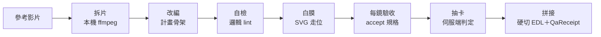

# nikuniku 導演工作台（director kit）

🌐 [English](README.md) · **繁體中文** · [日本語](README.ja.md)

把一支短影音或短劇的**結構**——節奏、鏡頭語法、鉤子位置——拿來重拍成你自己的新故事。可以從命令列用，也可以讓支援 MCP 的 IDE agent 來用。

> **狀態：配方執行尚未接上正式服務。** 下面每一步都能對測試附帶的本機 mock 伺服器完整跑完；對 `https://api.nikuniku.ai` 則要等 [SPEC §8](SPEC.md) 的伺服端介面上線，在那之前 `shoot`／`run` 會停在 `ACCEPTANCE_UNAVAILABLE`。這個工具本身不會產生任何影片。

## 能做什麼

客戶端負責準備與檢查；伺服端負責生成與判定。



| 步驟 | 指令 | 在哪跑 | 需要 key |
|---|---|---|---|
| 記錄參考片與授權狀態 | `source` | 本機 | 否 |
| 切鏡偵測、關鍵幀、匯入 SRT | `breakdown` | 本機（ffmpeg） | 否 |
| 一或兩份拆解合成計畫骨架 | `plan` | 本機 | 否 |
| 抓出憑空出現的人物、未入場就用的道具、時間線倒退、抄來的台詞 | `lint` | 本機 | 否 |
| 把場景方塊經每鏡相機投影成 SVG | `whitebox` | 本機 | 否 |
| 一次報價、送出、輪詢一個 take；採用第一個**伺服端**判定通過的 | `shoot` | nikuniku `/v1` | 是 |
| 逐鏡向伺服端再核對一次，然後拼接 | `assemble` | 本機＋`/v1` | 是 |
| 離線複驗已完成的成片 | `assemble --verify` | 本機 | 否 |
| `shoot` → 下載 → `assemble` 一次走完 | `run` | nikuniku `/v1` | 是 |

幾條貫穿全部的規則：

- **只復刻結構。** 骨架不搬原片台詞、人物、道具；改編由你或你的 IDE agent 寫。`lint` 會標出跟原片太像的台詞（L004）。某個用法是否合法不是這個工具能判斷的，需要律師。
- **每一鏡在送出前就寫好怎麼驗收。** 沒有 `accept` 的鏡會被拒絕，一個請求都不送。
- **客戶端從不自己判定 take。** 只採用伺服端判為 `passed` 的第一個 take；同一類失敗三次就停；沒有「全失敗就挑最好的」。
- **本機紀錄不是證明。** ledger 與 QaReceipt 誰拿著都能改，所以 `assemble --verify` 一律回報 `server_acceptance: "unverified"`。

## 五分鐘用 mock 跑起來

需要 Node 22 以上與 ffmpeg，在 repo 根目錄執行。

```bash
npm install
node scripts/make-fixtures.mjs
mkdir -p demo
```

準備階段——不需要 key、不連網：

```bash
node cli/nikuniku.mjs source --file fixtures/x.mp4 --rights unknown --source-lang en --out demo/source.json
node cli/nikuniku.mjs breakdown fixtures/x.mp4 --source demo/source.json --frames demo/frames --out demo/breakdown.json
echo "Keep the rhythm, tell a new story: a rainy night in a small bookshop." > demo/brief.txt
node cli/nikuniku.mjs plan --a demo/breakdown.json --brief demo/brief.txt --plan-lang en --project demo --out demo/plan.json
node cli/nikuniku.mjs lint demo/plan.json --source demo/breakdown.json --out demo/lint-report.json
node cli/nikuniku.mjs whitebox schemas/examples/plan.ab-merge.json --dir demo/whitebox
```

`lint` 會通過，附三個 `L006_ACCEPT_MISSING` 警告：骨架把 `accept` 留空給你填。

用範例計畫（每鏡已寫好 `accept`）對本機 mock 拍攝與拼接：

```bash
node -e 'const fs=require("fs");const p=JSON.parse(fs.readFileSync("schemas/examples/plan.ab-merge.json","utf8"));p.sources=[];fs.writeFileSync("demo/shoot-plan.json",JSON.stringify(p,null,1))'
node --input-type=module -e "import {start} from './tests/mock-api.mjs';const m=await start({director:{files:{s1:'fixtures/takes/s1.mp4',s2:'fixtures/takes/s2.mp4'}}});console.log(m.base)" > demo/mock-url &
MOCK_PID=$!
sleep 1
export NIKUNIKU_API_BASE=$(cat demo/mock-url) NIKUNIKU_API_KEY=nk_test_mock_key NIKUNIKU_POLL_MS=50
node cli/nikuniku.mjs run demo/shoot-plan.json --out demo/out/final.mp4
node cli/nikuniku.mjs assemble --verify demo/out/qa-receipt.json --takes demo/out/takes
kill $MOCK_PID
```

第一行拿掉範例的 `sources`（它們指向佔位的拆解檔）。`nk_test_mock_key` 是 mock 自己的測試 key，不是真的。跑完會得到 `demo/out/final.mp4`、`gacha-ledger.json`、`edl.json`、`qa-receipt.json`；最後一行指令會印出成片相符，以及「未經 nikuniku 驗收」。

## 從 IDE agent 使用

同樣的功能是既有 `nikuniku` MCP server（`mcp/nikuniku-mcp.mjs`）上的工具，用同一把 key：

| 工具 | 需要 key | 副作用 |
|---|---|---|
| `nikuniku_director_validate` | 否 | 無 |
| `nikuniku_director_lint` | 否 | 無 |
| `nikuniku_director_whitebox` | 否 | 寫一個 SVG |
| `nikuniku_director_take_submit` | 是 | 預留點數；每次呼叫最多一個新 take |
| `nikuniku_director_take_status` | 是 | 更新 ledger；永不送出 |
| `nikuniku_mv_draft` | 是 | 上傳圖與歌、存草稿與報價；不送出 |

一般套件不含成人工具或成人主機；加入任何一個，server 都會拒絕啟動。

## 輸出約定

- stdout 只有一行 JSON。
- 出錯時 stderr 第一行是不翻譯的 JSON `{ok:false,error:{code,message}}`，第二行是本地化訊息（十四語，`--lang` 或 `NIKUNIKU_LANG`）。
- exit code：`0` 成功 · `1` API／網路／執行期錯誤 · `2` 送出前就拒絕 · `3` 檢查未過 · `4` 超過點數上限。完整錯誤碼見 [SPEC §5](SPEC.md)。

## 怎麼擴充

- **資料契約**在 `schemas/*.schema.json`。每個階段寫一份 JSON，以 sha256 綁定上一階段。在 `schemas/examples/` 加正例、`schemas/examples/invalid/` 加反例，再跑 `node scripts/validate-schemas.mjs`。
- JSON Schema 表達不了的**跨欄位規則**寫在 `director/semantics.mjs`。
- **新的 lint 規則**寫在 `director/lint.mjs`，給穩定的 code（`L0xx_…`），在 `tests/lint-fixtures.test.mjs` 加 fixture 測試，並在 SPEC §3 S4 加一列。
- **新的錯誤碼**要在 SPEC §5 加一列，並在十四個 `locales/director/*.json` 都加 `error.<CODE>`；否則 `tests/locales.test.mjs` 會失敗。
- **每個防護都要有「拿掉它就會紅」的測試。** 刪掉那一行跑 `npm test`，應該變紅。

`npm test` 在本機對 mock 跑完整測試，不會呼叫真正的 API。

## 延伸閱讀

- [SPEC.md](SPEC.md)：完整設計——S1–S10 各階段、資料契約、驗收標準、伺服端介面草案。
